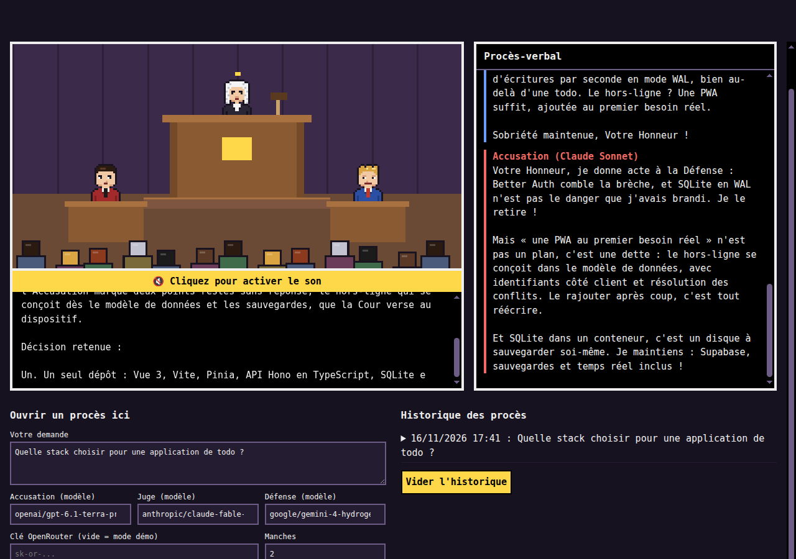

# ⚖ Tribunal des IA

Une salle d'audience en pixel art où des agents IA plaident, objectent et tranchent vos décisions techniques.

Vous posez une question (« quelle stack pour mon application ? ») ou vous soumettez une pièce à juger (un fichier, un artefact). La Défense propose, l'Accusation attaque, un témoin expert vient à la barre, ils se répondent, le jury vote à main levée, puis le Juge rend un verdict avec une décision en étapes concrètes. Le tout se joue à l'écran, avec public, objections, musique et coups de marteau.



## Essayer tout de suite

Ouvrez `index.html` dans un navigateur, tapez une demande et cliquez sur « Ouvrir l'audience ».

Sans clé, la page joue un procès de démonstration avec des répliques écrites d'avance. Il n'y a rien à installer : pas de dépendance, pas de build, pas de serveur.

## Trois façons de tenir un procès

### 1. Mode démo

Aucune configuration. Sert à voir la scène et à entendre le son.

### 2. Avec des modèles au choix, via OpenRouter

Collez une clé [OpenRouter](https://openrouter.ai) dans le formulaire et choisissez un modèle par rôle (le témoin et le jury utilisent celui du Juge ; dans ce mode, les cinq votes du jury viennent d'un seul appel au modèle). Les réponses arrivent en streaming.

La clé est enregistrée dans le `localStorage` de votre navigateur et n'est envoyée qu'à `openrouter.ai`. C'est adapté à un usage local, pas à une page hébergée pour d'autres.

### 3. Depuis Claude Code, avec la commande `/objection`

Les trois rôles sont des agents Claude lancés depuis votre session : pas de clé API, et ils peuvent lire vos fichiers ou vos artefacts.

```
/objection quelle stack pour une app de todo ?
/objection src/checkout.ts
/objection https://claude.ai/artifact/...
```

La salle s'ouvre dans le navigateur dès le début et suit l'audience en direct : elle montre qui prépare sa prise de parole, puis joue chaque réplique dès qu'elle est rendue. Le verdict est aussi donné dans le terminal.

**Installation** (Claude Code et Python 3 requis). Depuis la racine de ce dépôt :

```bash
ln -s "$PWD/skill/objection" ~/.claude/skills/objection
```

Le lien symbolique est nécessaire : la commande retrouve la salle à partir de l'emplacement du dépôt. Relancez Claude Code pour qu'il détecte la commande.

**Le règlement du tribunal.** Copiez `reglement.exemple.md` en `reglement.md` et écrivez-y vos critères permanents (qui vous êtes, vos priorités, ce que vous ne voulez pas). Les avocats et le Juge le lisent avant chaque procès, pour juger selon vous et pas dans l'absolu. Ce fichier reste sur votre machine, il n'est pas versionné.

**Après le verdict.** Si la décision contient des changements que Claude Code peut faire sur les pièces jugées, il propose de les appliquer, puis coche dans la salle les étapes faites.

**Le témoin expert.** Après la première manche, Claude Code appelle à la barre un spécialiste choisi selon les débats : un enquêteur qui vérifie un fait disputé dans les pièces ou sur internet, ou un expert d'un angle oublié (sécurité, coût, accessibilité...). Il établit les faits sans prendre parti.

**Le jury.** Avant le verdict, cinq jurés aux regards différents (le pragmatique, la sceptique, le comptable, l'utilisatrice, le mainteneur) votent à main levée, chacun avec sa raison. Ce sont cinq petits agents indépendants. Leur vote est consultatif : le Juge en tient compte et dit pourquoi s'il s'en écarte.

Un procès lance onze agents (deux manches, un témoin, cinq jurés, puis le Juge), donc il consomme sensiblement plus qu'une question ordinaire.

## Dans la salle

- **Procès-verbal** à droite de la scène, une couleur par rôle.
- **Fiches cliquables** : un clic sur un personnage ouvre sa fiche (rôle, modèle, prises de parole, temps de travail), un clic sur le dossier posé sur le pupitre du Juge ouvre l'affaire et ses pièces à conviction. Les boutons « Fiches » sous la scène font la même chose au clavier.
- **Décision de la cour** : les étapes numérotées du verdict deviennent une liste à cocher, mémorisée par procès, avec un bouton pour la copier en Markdown.
- **Historique** des 30 derniers procès, avec un bouton pour les rejouer dans la salle.
- **Son et musique** synthétisés dans le navigateur, avec un thème par orateur. Deux cases permettent de les couper.
- **Voix** : les plaidoiries sont lues à voix haute par la synthèse vocale du navigateur, avec une hauteur de voix par rôle. La qualité dépend des voix françaises installées sur votre système ; sans voix française, la case est désactivée.
- **Interrompre** arrête l'audience en cours.
- Un clic sur la boîte de dialogue affiche tout de suite le texte en train de s'écrire.

## Comment ça marche

| Fichier | Rôle |
|---|---|
| `index.html` | Toute la salle : scène sur un canvas, sprites décrits en texte, son en WebAudio, appels OpenRouter, historique. |
| `skill/objection/SKILL.md` | Les instructions de la commande `/objection` pour Claude Code. |
| `skill/objection/greffe.py` | Le greffe : écrit le procès en cours dans `proces.js` à la racine du dépôt, lit le règlement, coche les étapes appliquées. |
| `reglement.exemple.md` | Modèle de règlement du tribunal. |

La page ne peut pas lire de fichier local avec `fetch` quand elle est ouverte en `file://`. Elle recharge donc `proces.js` par une balise `<script>` toutes les quelques secondes, ce qui lui permet de suivre un procès en direct sans serveur.

Les sprites se retouchent directement dans `index.html` : une lettre correspond à un pixel.

## Limites connues

- Un seul procès à la fois : `/objection` écrase le procès précédent dans `proces.js` (il reste dans l'historique de la page).
- Si la salle est ouverte dans plusieurs onglets, chacun joue le procès.
- L'historique vit dans le navigateur : il ne suit pas d'un poste à l'autre.
- Le navigateur n'autorise le son qu'après un clic dans la page.
- L'interface et les plaidoiries sont en français.

## Licence

[MIT](LICENSE)
